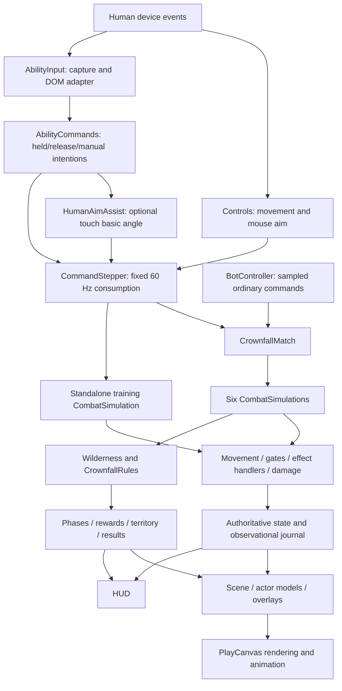

# Crownfall Arena — Goal 007I: Code Health Audit

Audit date: 2026-10-23. Repository: `kalikeefbiz/-Crownfall-Arena-Unity`.
Branch and audited baseline: `playcanvas-port`,
`7e48c8d40c0a6f9a4e3b1604804cc08b2562e32c`.

This is an audit, not approval to implement its recommendations. No gameplay,
rendering, balance, dependencies, assets, tests, or deployment configuration were
changed. References below describe the baseline, before this report was added.
Paths are relative to `PlayCanvas/` unless prefixed with `../`.

## 1. Executive Summary

Crownfall is **generally maintainable, with localized technical debt beginning to
accumulate**. Its strongest architectural decision survives the successive goals:
commands enter one combat implementation; match rules own lives and victory;
graphics read the outcome. There is no evidence of competing live damage,
cooldown, ticket, or hit-registration authorities. A rewrite would put well-tested
rules at unnecessary risk.

The main weaknesses are around that core. Character presenters repeat most of
their lifecycle code; `scene.ts` combines too many view responsibilities;
`main.ts` embeds substantial verification orchestration; HUD updates rebuild
unchanged DOM; and application teardown leaves the HUD and its handlers behind.
The scene also eagerly creates 768 projectile/effect view entities for the full
capacity of six simulation pools, including inactive slots. These are concrete
maintenance or allocation issues, not conclusions drawn from file length.

Some older implementations do remain: an unused-in-production movement path is
still tested as a simulation, number effects are generated after journal-based
damage numbers replaced their presentation, and several configuration exports
have no consumers. Conversely, primitive fallbacks, local previews, the legacy
environment comparison, reference geometry, and deployment compatibility remain
actively useful. Removing all of them would weaken verification and recovery.

The approximately 256 MiB texture allocation is a separate production concern.
Sharing is already working; nine embedded source textures explain most of the
footprint. Actual mobile loading, peak decode memory, frame pacing, thermal
behavior, and context recovery remain unverified here. Software Chromium timings
cannot establish iPhone performance.

Recommended action: approve small cleanup goals, beginning with lifecycle
ownership, accurate contracts, and presenter consolidation. Reduce known wasted
presentation work next. Preserve gameplay authority and meaningful tests. No
Critical or High correctness defect was established by this audit.

### Scope and validation boundary

- Read the 43 runtime JS/TS modules (5,869 lines), nine declaration files, the
  875-line stylesheet, asset metadata, build/test configuration, and relevant
  repository workflows. Reviewed unit/browser tests, helper implementations,
  milestone evidence, and relevant history. All 43 runtime modules are reachable
  from `main.ts`; the relative runtime-import graph has no cycle. Reachability of
  a module does not prove every export or branch is used.
- Clean checkout and exact baseline verified before inspection. No `AGENTS.md`
  was present. Unity, historical source assets, and hosted compatibility files
  were inspected only for scope/deployment context, not re-audited as active
  PlayCanvas gameplay.
- Fresh local `npm ci`, **207/207 unit tests in 21 files**, typecheck, ESLint,
  Prettier, and production build passed. The build produced the same
  `index-JJhsRHL1.js` entry named in Goal 007H evidence, with the existing chunk
  advisory: 1,305.58 kB minified / 352.19 kB gzip.
  Its SHA-256 also matches Goal 007H:
  `0de48a6aee519856f86f6ba536d5ea4d0bf0948bce42a3814376cbbd2a84ab4e`.
- Fresh full production browser rerun: **100/100 passed**, no retries, in
  **19.5 minutes**. This includes the natural match, all-six shared-resource and
  rematch checks, genuine multi-touch, assistance, terrain and Wilderness suites.
  Historical [Goal 007H evidence](evidence/007h/browser-full.txt) remains preserved.
- Additional disposable browser probes used the unchanged source via Vite,
  primitive mode, PlayCanvas `AppBase.getApplication()`, DOM mutation observation,
  explicit app destruction/remount, and isolated match instances. They confirmed
  CF-001, CF-004, CF-005, CF-007 and CF-011. These were functional probes, not
  concurrent performance benchmarks. Scripts/logs were kept under `/tmp`; normal
  build/browser artifacts stayed in ignored directories.
- Environment: Node 24.19.0, npm 11.9.0, Linux Chromium 154.0.8037.57 with ANGLE
  SwiftShader. No physical phone or Safari run, heap-retainer analysis, mutation
  score, or measured code-coverage percentage is claimed.

## 2. Architecture Map

### Systems and ownership

| System                             | Modules and responsibility                                                                                                     | Boundary assessment                                                                                                                                                                                                 |
| ---------------------------------- | ------------------------------------------------------------------------------------------------------------------------------ | ------------------------------------------------------------------------------------------------------------------------------------------------------------------------------------------------------------------- |
| Composition and frame loop         | `main.ts`: graphics device/AppBase, systems, UI/input wiring, fixed-step driver, preferences, verification API, teardown       | Correct composition point, but fixture/reset/UI orchestration has accumulated here (CF-001/003).                                                                                                                    |
| Human intentions                   | `input/controls.ts`, `input/game-gestures.js`: joystick/keyboard/mouse vectors, capture, interruption, scoped browser defaults | Movement pointer ownership is separate from ability pointer ownership. Gesture listeners cannot cast.                                                                                                               |
| Ability commands and assistance    | `combat/ability-commands.js`, `ability-input.js`, `human-aim.js`, `command-stepper.js`                                         | Pure command policy separated from DOM adapter. Assist selects an angle; combat still decides acceptance and hits.                                                                                                  |
| Movement and combat                | `movement.js`, `combat.js`, `combat-core.js`                                                                                   | Authoritative positions, collision, eligibility, cast gates, damage transactions, statuses, cooldowns and pools.                                                                                                    |
| Ability timelines                  | `advanced-actions.js`, `returning-weapons.js`, `modifiers.js`                                                                  | Timed contact/ground/barrage actions, persistent scythes and modifiers reuse combat damage/geometry. Separate handlers reflect different mechanics.                                                                 |
| Authored data                      | `combat-data.js`, `summoners.js`, `riven-data.js`, `config.js`                                                                 | Kit/Set/Riven definitions, effect parameters and reference defaults. Some retained config is misleading or unused (CF-007/010).                                                                                     |
| Match authority                    | `match.js`, `crownfall-rules.js`, `match-data.js`, `match-space.js`                                                            | Six combat instances share actor objects; match owns phases, spawns, records/assists; rules own territory, CP, tickets, final respawns and terminal result. Coordinate conversion is centralized.                   |
| AI                                 | `bot-controller.js`                                                                                                            | Seeded, sampled target/goal/action decisions and obstacle routing; submits ordinary commands. Independent of human assistance.                                                                                      |
| Wilderness                         | `wilderness.js`, `wilderness-data.js`                                                                                          | Camps, neutral pursuit/attacks, assignment scheduling, rewards/expiry. Neutral damage enters combat; its collision query has implicit human ownership (CF-011).                                                     |
| Presentation-facing state/training | `gameplay/simulation.ts`, `vector.ts`, `config/arena.ts`, `combat/sandbox.js`, `presentation/facing.ts`                        | Selects runtime mode and adapts facing/input state. Contains a retained earlier movement implementation that runtime disables (CF-008). Training uses current combat with its own diagnostic geometry.              |
| Arena and actor views              | `presentation/scene.ts`, `combat-overlay.ts`, `ability-preview.ts`                                                             | Camera, lights, terrain/fallbacks, actor roots/team feedback/health/labels, projectile/effect views, SVG previews and damage numbers. Reads authority; no gameplay collision components or animation hit callbacks. |
| Character resources/animation      | `summoner-assets.ts`, `kit-model.ts`, `set-model.ts`, `riven-model.ts`, corresponding `*-animation.ts`                         | Scene cache owns containers/bind normalization; actor instances own skeletons/controllers; corrected tracks are shared. Common lifecycle is duplicated, character clip policy is intentionally distinct.            |
| Environment art                    | `lane-geometry.ts`, `lane-environment.ts`                                                                                      | Five deterministic static mesh batches, one 128×128 texture; geometry reads map footprints. No terrain sampling feeds gameplay.                                                                                     |
| HUD                                | `ui/hud.ts`, `style.css`, `index.html`                                                                                         | Match/debug UI, ability controls, responsive/safe-area layout. DOM ownership and change detection need attention; responsive rules are active, not inherently redundant.                                            |
| Reliability and shipping           | `tests/`, Vitest/Playwright configs, Vite, ESLint/TypeScript/Prettier; `../.github/workflows/publish-crownfall-playcanvas.yml` | Strong local behavioral checks; browser/lint/format checks are not enforced by the publishing job (CF-015). Preview publishes under `/playcanvas/`, retaining Unity root.                                           |

### Input → simulation → presentation



`src/main.ts:276–317` samples input once per rendered update. The stepper
(`src/combat/command-stepper.js:5–24`) consumes intentions only when a 1/60-second tick is
available; `sim.match || sim` selects the authority. The match alternates actor
processing order (`src/combat/match.js:201–206`) and advances Wilderness/rules. Combat owns
the resulting movement, cast acceptance and damage. `Simulation.update(...,
false)` computes presentation policy; `src/main.ts:296–297` copies authoritative
position/collision diagnostics back into it.

The renderer uses simulation state and journals. Kit's accepted-basic response is
a visual window, not a damage timer (`src/presentation/kit-animation.ts:44–61`). Model scaling,
grounding and yaw affect child pivots, never collision roots. Set/Riven locomotion
does not inject combat events. PlayCanvas animation runs on render time; combat
runs on fixed ticks with a 100 ms frame-delta cap. The two clocks are intentionally
different and should not be joined through animation callbacks.

### Integrity conclusions

- **Combat:** `CombatSimulation.damage()` (`src/combat/combat.js:126–177`) applies modifiers,
  calls `applyDamage()`, records transactions/meter, and delegates match outcomes.
  Cone/radial/dash/projectile/contact/ground handlers call that same boundary.
  `CrownfallRules.defeat()` owns ticket/final-life spending. Preliminary cooldown
  checks in bots/input/UI are advisory; `executeCast()` is the final gate. They
  are not duplicate authorities.
- **AI:** `bot-controller.js` has no human-assist import. Its target scoring,
  sampled error, hysteresis and path routing serve a different responsibility
  from touch acquisition/line of sight. The On/Off replay test compares complete
  match/bot state (`tests/human-aim.test.js:234–248`). Do not consolidate the two
  target policies merely because both select enemies.
- **Animation/resources:** every rendered actor receives an independent entity
  hierarchy and anim component; container resources and corrected tracks are
  shared. Dead actors/results stop playback; local deselected presenters stop
  playing. Bounds traversal is diagnostic/load-time work, not the normal frame
  path. Respawn/rematch reuse is intentional and tested.
- **Environment:** `MATCH_WORLD` supplies collision rectangles and visual obstacle
  footprints. Generated relief stays inside those footprints/outside map bounds;
  legal footing remains near Y=0. `tests/lane-geometry.test.ts:27–76` checks raised
  triangles, access footing, normals/UVs and budget. Meshy GLBs can later replace
  decoration beneath a presentation root, with shared owned assets and explicit
  placement/clearance checks. Importing their render mesh must not silently change
  navigation, hit tests or map elevation.
- **Input:** `Controls` and `AbilityInput` both observe keyboard/interruption
  events for different intentions. This does not cause two damage commits.
  Captures are cleared on blur/visibility/orientation/layout resize. The scoped
  touch/gesture guards preserve menu defaults. One extra canvas `contextmenu`
  suppressor is redundant (CF-010). Browser compatibility controls remain useful.

## 3. Technical Debt Register

Severity criteria: **Critical** = established pervasive failure/data loss;
**High** = established serious correctness failure or demonstrated production
blocker; **Medium** = concrete localized defect, repeated maintenance burden, or
material unresolved production risk; **Low** = bounded redundancy/housekeeping.
Effort is relative: Small = a focused change; Medium = several modules with
regression work; Large = cross-system or asset/device validation work. Risk below
describes implementing the recommendation, not permission to do it now.

### CF-001 — Application teardown leaves live UI ownership behind

- **Severity:** Medium. **Status:** Confirmed lifecycle defect; no ordinary
  same-page rematch leak inferred.
- **References:** [src/main.ts:84–94](src/main.ts#L84-L94),
  [100–151](src/main.ts#L100-L151), [319–375](src/main.ts#L319-L375);
  [src/ui/hud.ts:31–43](src/ui/hud.ts#L31-L43), `src/ui/hud.ts:244–246`.
- **Evidence:** app destruction disposes scene/input/abilities and resize only.
  HUD has no `destroy()`; startup click/change handlers have no cleanup owner;
  `window.__crownfall` retains closures. An unchanged-source browser probe left
  one `<main>` after `app.destroy()`; its snapshot threw on disposed mesh instances.
  Explicit remount produced two `<main>` elements and two `#summoner` IDs.
- **Impact/action:** stale handlers and ambiguous selectors during HMR/remount;
  future embedded/menu lifecycle is unsafe. Give the app/HUD one disposal owner,
  abort startup bindings, remove owned DOM and invalidate the diagnostic API.
- **Regression risk:** Medium (capture/interruption and initialization order).
  **Effort:** Medium. Add real mount/destroy/remount coverage first.

### CF-002 — Three presenters copy lifecycle rather than just character policy

- **Severity:** Medium. **Status:** Confirmed duplication.
- **References:** `src/presentation/kit-model.ts:21–30,70–161,163–204`;
  `src/presentation/riven-model.ts:18–33,78–168,171–211`;
  `src/presentation/set-model.ts:18–33,79–168,171–211`.
- **Evidence:** repeated bounds validation/normalization, loading promise,
  instantiate/validate/normalize/attach/error fallback, identity reset, yaw,
  movement detection, visibility, diagnostics and destruction. Riven/Set bodies
  are almost identical. All already use `SummonerAssets` and the same in-place
  track correction, demonstrating successful lower-level reuse.
- **Impact/action:** each lifetime/facing fix needs three synchronized edits.
  Extract a small common presenter lifecycle with character data/policy hooks.
  Retain Kit punch/static comparison, Set Ready sampling, rig joint counts,
  heights/offsets and Riven clip validation as explicit character policy.
- **Regression risk:** Medium–High (grounding, fallback and async identity races).
  **Effort:** Medium. Preserve per-actor anim ownership and current snapshots.

### CF-003 — Composition modules have several independent reasons to change

- **Severity:** Medium. **Status:** Confirmed responsibility concentration;
  future catalog growth is a potential concern.
- **References:** `src/presentation/scene.ts:32–214,299–548`; `src/main.ts:96–151,154–272,276–317`;
  `src/ui/hud.ts:13`; `src/combat/match.js:27–31`; `src/presentation/scene.ts:143–145,457–462`.
- **Evidence:** scene update reconciles actor/camp DOM, health/primitive views,
  model selection, effects, camera and SVGs. Main mixes reset duplicates with 20
  verification fixture names and direct fixture state edits. A summoner addition
  touches catalog, HTML options, roster policy and hardcoded presenter selection.
- **Impact/action:** changes to unrelated features share closures and ordering.
  Extract actor views, pooled views, camera/projection and fixture construction
  one at a time. Consolidate reset as a direct function rather than synthetic
  button clicks. Before adding a summoner, distinguish selectable catalog from
  the fixed three-person roster; never enlarge matches by iterating all entries.
- **Regression risk:** Medium–High. **Effort:** Large overall, divided into Medium
  extractions. Preserve current update order initially; avoid a general ECS rewrite.

### CF-004 — Inactive pool capacity becomes hundreds of unnecessary view entities

- **Severity:** Medium. **Status:** Confirmed allocations; frame-rate impact
  unmeasured.
- **References:** `src/combat/combat.js:40–41`; `src/combat/combat-core.js:118–130`;
  [src/presentation/scene.ts:489–519](src/presentation/scene.ts#L489-L519).
- **Evidence:** `flatMap` includes every pool item; `shots[index] ||=` and
  `flashes[index] ||=` run before checking `active`/supported type. Six actors
  therefore allocate 6×32 projectile and 6×96 effect views. Browser inspection
  in primitive prematch confirmed **192 + 576**, among 844 total entities.
- **Impact/action:** unnecessary startup components/transforms and full-capacity
  scans; cost scales with actors/pool sizes. Keep simulation pools unchanged;
  lazily allocate/reuse presentation views for active, renderable entries only.
  Preserve persistent-scythe identity/visibility and effect expiry.
- **Regression risk:** Medium (pool-slot reuse and persistent projectiles).
  **Effort:** Medium. Validate active→inactive→reused slots, not just counts.

### CF-005 — Unchanged HUD/DOM is repeatedly rebuilt or rewritten

- **Severity:** Medium. **Status:** Confirmed repeated work; no measured FPS loss.
- **References:** `src/ui/hud.ts:45–71,81–93,127–159,207–243`;
  `src/main.ts:299–309,313–316`; `src/combat/ability-input.js:88–104`;
  `src/presentation/scene.ts:336–342,362–371`; `src/presentation/combat-overlay.ts:61–94`.
- **Evidence:** team rows are replaced every HUD refresh (up to 10 Hz); completed
  result rows are also rebuilt indefinitely. Hidden diagnostics are formatted
  during normal play, including a computed-style read. Ability labels/CSS and
  aim feedback are written each render update. Mutation observation in unchanged
  prematch confirmed team-row replacement and loss of row identity.
- **Impact/action:** DOM allocation/style work and future focus/accessibility
  instability. Cache node references; update changed fields; build participant
  rows once per roster/result; skip hidden diagnostic formatting. Keep world-label
  projection and genuinely changing cooldowns at their necessary cadence.
- **Regression risk:** Medium (stale rows on reset/identity change).
  **Effort:** Medium. Assert stable unchanged row identity and correct changed data.

### CF-006 — Handwritten declarations overstate runtime guarantees

- **Severity:** Medium. **Status:** Confirmed contract mismatch.
- **References:** `tsconfig.json:17–20`; `src/combat/combat.d.ts:1–34,46–61,99–103`;
  `src/combat/combat.js:87–96`; `src/combat/combat-journal.js:14–25,29–46`;
  `src/combat/match.d.ts:2–15,46–47` versus `src/combat/match.js:51–71,231–235`.
- **Evidence:** `ability()` is declared always `Ability`, but returns `null` for
  unknown IDs. Rejected journal entries lack `ability`, `origin`, `angle` and
  `pending`, all required by `CastEvidence`. Modifier records permit numbers only
  although camp labels are strings. `MatchActor` combines live actor and snapshot
  fields. JS checking is off; a green typecheck does not validate these contracts.
  A direct runtime probe confirmed missing-ability `null` and missing reject fields.
- **Impact/action:** future observers can compile unsafe reads. Define accepted/
  rejected discriminated records, nullable lookups, command shapes, and distinct
  live/snapshot actor types; incrementally check JS boundaries. No whole-language
  migration is necessary.
- **Regression risk:** Low–Medium. **Effort:** Medium.

### CF-007 — Several published settings are ignored by their actual owners

- **Severity:** Medium. **Status:** Confirmed misleading configuration; current
  defaults match, so no present balance divergence established.
- **References:** `src/combat/match-data.js:2–14,80–101`; `src/combat/match.js:20,66,196`;
  `src/combat/combat.js:158–160`; `src/ui/hud.ts:76,79,108–113`.
- **Evidence:** validated `countdownSeconds`, `protectionSeconds`,
  `durabilityMultiplier`, `ultimateDealt` and `ultimateReceived` coexist with
  hardcoded effective values 3, 2, 1.3, .04, .025. HUD also hardcodes grace/CP
  target and buff percentages. A probe set `rules.settings.protectionSeconds=9`;
  respawn still granted two seconds (1.9833 remained after the next tick).
- **Impact/action:** future tuning can silently change reported config without
  changing behavior. Establish one honest configuration contract: wire supported
  values through owners or remove unsupported settings. Render values from that
  contract. Preserve every current effective default and transaction.
- **Regression risk:** Medium (economy/lifecycle). **Effort:** Medium.

### CF-008 — Earlier movement implementation remains inside the active adapter

- **Severity:** Medium. **Status:** Confirmed superseded runtime path, still
  exercised by tests.
- **References:** `src/gameplay/simulation.ts:44–71`; `src/config/arena.ts:1`;
  `src/main.ts:286–297`; `src/combat/movement.js:39–56`;
  `tests/logic.test.ts:46–88`.
- **Evidence:** runtime always calls `Simulation.update` with `move=false` and
  copies combat position afterward. Its default `move=true` path still implements
  separate speed-5 collision/movement; runtime combat speed is 6. History traces
  this path to foundation commit `89fd12e`; combat bypassed it in `52c5198`.
  Unit collision/diagonal tests in `logic.test.ts` still test the earlier path.
- **Impact/action:** misleading simulation ownership and tests that cannot catch
  regressions in live movement. Move useful movement assertions to authoritative
  movement/command integration, preserve facing tests, then retire or explicitly
  isolate the old harness. Keep training map geometry used by real sandbox tests.
- **Regression risk:** Medium. **Effort:** Medium.

### CF-009 — Superseded presentation outputs are still generated in combat

- **Severity:** Low. **Status:** Confirmed unconsumed outputs; optional callback
  retirement needs explicit scope.
- **References:** `src/combat/combat.js:162–176,256–260,288,301`;
  `src/combat/advanced-actions.js:10,76,91,134–138,167`; `src/combat/returning-weapons.js:76`;
  `src/presentation/scene.ts:514`; `src/presentation/combat-overlay.ts:102–123`.
- **Evidence:** damage emits pooled `type:'number'` effects while the visible
  numbers read journal hits. Scene renders only trail/pantherTrail/buffPulse
  from that pool. No presentation/test consumer reads `advanced.pose`; no source/test assigns
  a combat `feedback` emitter. One damage probe produced both a number-pool entry
  and a journal hit. Journal-based feedback arrived in `cb96630` without retiring
  the former output.
- **Impact/action:** dead visual work occupies a bounded VFX pool and obscures
  the future animation/audio seam. Retire unobserved number/pose production after
  parity checks; document or deprecate unused emitter hooks separately. Preserve
  journal hit/attempt correlation, transactions, and active world effects.
- **Regression risk:** Low–Medium. **Effort:** Small.

### CF-010 — Small confirmed unused definitions and inactive scaffolding

- **Severity:** Low. **Status:** Confirmed no current consumers; some scaffolding
  requires replacement of its interface before retirement.
- **References:** `src/combat/match-data.js:59–79`; `src/combat/movement.js:59–68`;
  `src/vite-env.d.ts:3–19`; `src/style.css:95–105,145–148`;
  `src/combat/ability-input.js:96`; `src/presentation/scene.ts:146–150,533–534`;
  `src/input/controls.ts:24,83`; `src/input/game-gestures.js:14`.
- **Evidence:** repository source/test searches find no consumer of
  `MATCH_TRAINING`, `BOT_CONFIG`, or `LocalCommandSource`, and no imports of the
  three declared PlayCanvas helper scripts. No DOM creates `.skills`; no CSS reads
  `--cool`. The old continuous-aim line is always disabled on update. Canvas
  context-menu prevention is installed twice. The hidden `#aim` pad still has
  adapter branches, so it is not simply an unreferenced file.
- **Impact/action:** misleading tuning/API surfaces and minor noise. Remove the
  proven unreferenced declarations/exports/styles/write; deprecate hidden-pad and
  disabled-line scaffolding through a focused browser regression. Do not infer
  that other compatibility flags or all reference data are unused.
- **Regression risk:** Low, Medium for input scaffolding. **Effort:** Small.

### CF-011 — Collision queries carry human state and implicit radius

- **Severity:** Medium. **Status:** Confirmed coupling/radius discrepancy;
  naturally occurring camp-wall penetration not established.
- **References:** `src/combat/movement.js:30–37`; `src/combat/bot-controller.js:17–35,53`;
  `src/combat/wilderness.js:18–23,168–179`; `src/combat/human-aim.js:12–16`;
  `tests/wilderness.test.js:386–394`.
- **Evidence:** `blocked()` increments a summoner's collision counter even for AI
  route probes. Wilderness uses `match.human.blocked()` for creatures whose radii
  are .7/1.3, but the query uses the human config radius .45. An isolated wall
  fixture at center (0,0), size 2×4 allowed center (1.6,0) through that query while
  `circleHitsWall(...,.7,...)` reported overlap. Human assistance explicitly avoids
  `blocked()` because of its side effect.
- **Impact/action:** diagnostics include planning/camp probes and geometry policy
  depends on the human adapter. Extract a pure occupancy query with explicit map
  and radius; preserve effective behavior first. Any change to creature clearance
  needs a separately approved gameplay verification, not an incidental refactor.
- **Regression risk:** Medium–High (routing/reachability). **Effort:** Medium.

### CF-012 — Texture/download footprint has no physical-device acceptance evidence

- **Severity:** Medium. **Status:** Confirmed footprint; potential mobile risk,
  not a confirmed device failure or duplicate-download leak.
- **References:** [Goal 007E:79–146](TASK_007E_VERIFICATION.md#loading-memory-and-performance),
  `evidence/007e/software-performance.json:14–51`;
  `evidence/007f/software-performance.json:98–103`;
  `public/assets/summoners/kit/README.md:18–36`;
  `src/presentation/summoner-assets.ts:26–48,60–65`.
- **Evidence:** three default GLBs total 48,110,624 bytes. Embedded image inspection
  confirms eight 2048² textures and Kit's 4096² metallic/roughness texture. Earlier
  measured scene texture allocations were 268,498,532 bytes; carved terrain adds
  87,380. Shared mesh/material IDs and three requests are tested.
  Fresh six-summoner browser diagnostics also reported 268,585,912 carved-scene
  texture bytes for each selected identity.
- **Impact/action:** substantial cold-load/decode/GPU budget before weapons,
  environment assets and VFX. Establish real-device budgets and a repeatable
  profiling gate. If necessary, approve derived runtime assets separately while
  preserving originals, appearance and provenance. Do not silently alter hashes
  or claim compressed transfer bytes equal resident memory.
- **Regression risk:** Low for measurement, High for later asset changes.
  **Effort:** Large overall; measurement is a separate Medium-sized first goal.

### CF-013 — Reliability gaps at lifecycle and visual-verification boundaries

- **Severity:** Medium. **Status:** Confirmed missing safeguards; unmeasured
  failure prevalence.
- **References:** `tests/summoner-assets.test.ts:11–61`;
  `tests/ability-input.test.js:6–60,190–214`;
  `tests/browser/six-summoner.spec.ts:151–202`;
  `tests/browser/playable.spec.ts:12–64`;
  `tests/browser/ergonomics.spec.ts:184–223`.
- **Evidence:** cache tests fake registry loading and fire asset events; input
  stubs ignore AbortSignal behavior. Existing rematch tests do not destroy the app.
  No real app teardown/in-flight engine-load/context-recovery test was found.
  Screenshots are saved but never asserted against approved images. The long
  banner test changes DOM while the live HUD can overwrite it before geometry
  reads. Negative hold/countdown checks sometimes wait wall time rather than
  proving simulation time progressed.
- **Impact/action:** suites can stay green despite CF-001, rendering defects, or
  vacuous negative timing assertions. Add focused observable tests before relevant
  refactors; freeze the intended UI state atomically for layout checks and wait
  for simulation deadlines. Retain natural full-match and real-touch coverage.
- **Regression risk:** Low–Medium. **Effort:** Medium, staged with each cleanup.

### CF-014 — Asset test utilities and browser harness types are copied

- **Severity:** Low. **Status:** Confirmed duplication.
- **References:** `tests/helpers/riven-asset.ts:7–162` and
  `tests/helpers/set-asset.ts:7–162`;
  `tests/browser/riven-model.spec.ts:4–60,71–119` and
  `tests/browser/set-model.spec.ts:4–60,71–119`;
  `tests/helpers/measure-roster.ts:100–113`,
  `tests/helpers/measure-environment.ts:80–95`.
- **Evidence:** the 162-line GLB/accessor/skinning helpers differ only in asset
  binding and two exported function names. Browser inspection types/setup are
  repeated. Measurement helpers write directly into historical tracked evidence
  paths; running them again can overwrite prior evidence.
- **Impact/action:** duplicated fixes and fragile evidence retention. Extract a
  small parameterized asset reader and typed browser/touch harness; keep independent
  skinning assertions and character-specific expectations. Allow an explicit output
  directory with ignored/default temporary output for new measurements.
- **Regression risk:** Medium (shared helper bugs can mask both assets).
  **Effort:** Medium. Cross-check representative vertices and source hashes.

### CF-015 — Publishing is not gated by the full validation contract

- **Severity:** Medium. **Status:** Confirmed automation gap; no failed release
  inferred.
- **References:** [publish workflow:3–9,34–58](../.github/workflows/publish-crownfall-playcanvas.yml#L3-L58);
  `package.json:8–20`; `playwright.config.ts:4–20`.
- **Evidence:** branch pushes touching any `PlayCanvas/**` path run install,
  unit tests, typecheck and build, then publish. No browser, lint or formatting
  gate exists there; no separate PlayCanvas pull-request validation workflow was
  found. Documentation-only pushes also match the deployment path filter.
  The audited baseline is itself a documentation commit and has a successful
  [push-triggered publishing run](https://github.com/kalikeefbiz/-Crownfall-Arena-Unity/actions/runs/39950560766).
- **Impact/action:** a browser-only regression may be published despite local
  evidence, and an audit commit can unintentionally redeploy. Separate validation
  from publication; run a focused browser gate on changes and retain a full-suite
  release gate, with reproducible build provenance. Exclude docs-only publication.
  Preserve `/playcanvas/`, relative base and existing Unity-hosted root.
- **Regression risk:** Medium (release plumbing). **Effort:** Medium. This audit
  must not trigger a gameplay publication.

## 4. Duplication and Dead-Code Assessment

There are no wholly orphaned runtime modules. The confirmed redundancy is inside
reachable modules. Searches covered source/tests and relevant repository callers;
absence of a current caller is distinguished from a compatibility path invoked
by URL, DOM or the test harness.

| Retained system/output                                                                 | Classification                         | Evidence and disposition                                                                                                                                                                                                                |
| -------------------------------------------------------------------------------------- | -------------------------------------- | --------------------------------------------------------------------------------------------------------------------------------------------------------------------------------------------------------------------------------------- |
| Kit/Set/Riven import, normalization, facing, fallback, snapshot and dispose code       | **Consolidate**                        | CF-002. Shared lifecycle, explicit rig/clip policies; do not merge animation controllers or character mechanics.                                                                                                                        |
| Riven/Set GLB parsing and offline skinning helpers                                     | **Consolidate**                        | CF-014; four binding/name substitutions distinguish the two files. Keep this independent calculation as a grounding oracle.                                                                                                             |
| Main select/reset sequence and restart-via-click plumbing                              | **Consolidate**                        | `src/main.ts:100–130`: same selection, accumulator/input/definition reset sequence twice. One reset function should serve all paths.                                                                                                    |
| Old `Simulation.moveAxis()`                                                            | **Deprecate**                          | CF-008: bypassed in every runtime frame, still tested. First migrate useful behavior assertions to actual combat movement.                                                                                                              |
| Pooled damage-number output and unused pose writes                                     | **Remove**                             | CF-009: no active visual consumer; journal/overlay supplies the replacement. Safe for current behavior after focused hit-feedback regression; retain the journal. No deletion performed here.                                           |
| `MATCH_TRAINING`, `BOT_CONFIG`, `LocalCommandSource`                                   | **Remove**                             | CF-010: definitions only across source/test caller searches. Live match/Wilderness/bot configuration is elsewhere. The unused networking wrapper does not implement networking.                                                         |
| Unimported helper-script declarations, `.skills` styles, unused `--cool` write         | **Remove**                             | CF-010: no imports/DOM/CSS consumers. Preserve Vite's client type reference.                                                                                                                                                            |
| Always-disabled continuous aim line and hidden aim-pad branch                          | **Deprecate**                          | `src/presentation/scene.ts:146–150,534`; `src/ui/hud.ts:28`; `src/input/controls.ts:26–63`. Current ability previews/mouse aim replace their visible role; remove only after equivalent input/facing regression.                        |
| Uncalled combat station/damage-pulse/target-fire helpers and optional feedback emitter | **Deprecate**                          | `src/combat/combat.js:58,76–85,113–124,486–502`; no runtime/test entry activates target fire or calls those helpers. Isolate reference fixtures before removing data; avoid inventing an audio/event framework to justify unused hooks. |
| Training targets, patrol seam, reference `MAP`, `LANE` and `*_TRAINING` data           | **Retain**                             | Parity tests construct reference combat and old lane fixtures; sandbox has real controls. Target patrol is exercised by combat/status tests. These are not evidence of a second competitive map authority.                              |
| Primitive model fallback and `models=primitive`/per-character switches                 | **Retain**                             | Async load/failure recovery and cost isolation; `tests/browser/six-summoner.spec.ts:204–242`. Not replaced by successful imports.                                                                                                       |
| Kit 10K asset/static comparison                                                        | **Retain**                             | `src/presentation/kit-model.ts:10,43–44`; `tests/browser/kit-model.spec.ts:162–173` requests and checks it. All four public GLBs have active paths; no unused GLB established.                                                          |
| Riven/Set preview and `summonerModels=local` switches                                  | **Retain**, consolidate plumbing later | Current character/touch regression suites use isolated imports and load/error comparisons. They are active diagnostic modes, not abandoned features.                                                                                    |
| Riven fast-loop inspector / Set sampled Ready                                          | **Retain**                             | Measured clip quality and absent supplied idle justify different policies. Runtime locks Riven to Running; `selectRivenRunTrack()` remains diagnostic and should be named/executed accordingly during presenter cleanup.                |
| Legacy environment and territory tint switches                                         | **Retain**                             | Matched environment recovery/parity tests, `tests/browser/environment.spec.ts:33–64`. Carved terrain adds no collision authority.                                                                                                       |
| Transactions, journal hits/attempts, and result records                                | **Retain**                             | Different bounded observations: damage provenance, async HIT/MISS correlation, presentation, KDA/results. Multiple logs are not multiple damage calculations.                                                                           |
| Browser gesture protection, capture resets, WebGL2 fallback error message              | **Retain**                             | Real touch/interruption tests and explicit Safari limits. Two keyboard/interruption listeners serve different owners; remove only the duplicate canvas context-menu suppression.                                                        |
| Unity project, ZIP/source provenance, Unity workflows/root hosting                     | **Retain**                             | Outside active-port cleanup scope; deployment intentionally coexists with Unity.                                                                                                                                                        |

CSS contains incremental overrides, including `#team-status` placement at
`src/style.css:493–503,594–599,656–660,723–725,757–759,780–782`, and diagnostics placement
at `213–216,229–233,272–277`. Several earlier values are shadowed, but the final
media/mode cascade is active. This is a consolidation opportunity after recording
computed layouts, not proof that every repeated selector is dead or that current
controls overlap.

## 5. Performance and Resource Risks

### Verified measurements and bounded behavior

| Observation                                                                                    | Evidence                                                                                                            | Interpretation                                                                                                                                                                                                                                           |
| ---------------------------------------------------------------------------------------------- | ------------------------------------------------------------------------------------------------------------------- | -------------------------------------------------------------------------------------------------------------------------------------------------------------------------------------------------------------------------------------------------------- |
| Three default GLBs: 26,939,896 + 10,000,416 + 11,170,312 = **48,110,624 bytes**                | Fresh binary inspection; asset constants and Goal 007E evidence                                                     | Original payload size; not a mobile transfer-time estimate. Static Kit adds 5,317,848 only when its comparison is requested.                                                                                                                             |
| Legacy six-model scene: **268,498,532 texture bytes**; carved: **268,585,912**                 | Historical `evidence/007e` and `007f/software-performance.json`                                                     | About 256.06 / 256.14 MiB of engine allocation for the entire scene. Not per actor, OS residency, peak process memory, or JS heap.                                                                                                                       |
| Eight 2048² maps plus one 4096² map                                                            | Fresh extraction of embedded image dimensions                                                                       | RGBA mipmapped storage predicts approximately 256 MiB. Kit's 4096² metallic/roughness map alone accounts for roughly 85.33 MiB at that representation. This explains the footprint without asserting that a particular reduction is visually acceptable. |
| Three unique requests/bind calculations, six independent model GUIDs, shared mesh/material IDs | `src/presentation/summoner-assets.ts:26–56`; `tests/browser/six-summoner.spec.ts:83–131` and milestone measurements | Resource sharing already exists. Ordinary rematches preserve instances; warmed selections stabilize `tex/vb/ib` counters (`151–202`).                                                                                                                    |
| 192 projectile + 576 effect view entities before action                                        | Fresh primitive-mode functional probe; CF-004                                                                       | Confirmed unnecessary capacity allocation. No quantified performance gain claimed.                                                                                                                                                                       |
| Unchanged prematch rows are replaced; app destroy leaves HUD/API                               | Fresh DOM/lifecycle probes; CF-001/005                                                                              | Confirmed lifecycle/DOM work. The probes were not FPS benchmarks.                                                                                                                                                                                        |
| Environment has five static batches and one 87,380-byte mipmapped grain texture                | `src/presentation/lane-environment.ts:16–85`                                                                        | No per-frame terrain generation or terrain GLB download. Mesh/material/texture have explicit destruction.                                                                                                                                                |

Historical software frame intervals are retained in Goal 007E/007F reports with
their sampling methods. They are slow and noisy even for primitives; they do not
support physical iPhone frame-rate conclusions. No fresh hardware benchmark was
attempted. The browser suite validates functionality, not sustained performance.

### Risks requiring measurement or targeted verification

- **Peak load/decode and future art budget:** all default containers remain cached
  for the scene, intentionally surviving rematches. After selecting all three
  characters, local presenters can retain two inactive model instances in addition
  to the six visible instances; this is bounded caching, not demonstrated growth.
  Quantify native decode memory and device behavior before adding many GLBs/VFX.
- **Teardown while real requests are pending:** presenter destruction guards and
  cache late-unload callbacks are present (`src/presentation/summoner-assets.ts:69–79`), but mock
  event tests do not prove engine loader/GPU behavior during full app disposal.
  No confirmed imported-entity leak in ordinary respawn/rematch was found.
- **Rebuilt ability bars:** `setDefinition()` replaces DOM using one long-lived
  AbortController (`src/combat/ability-input.js:11,27–75`). Rapid stance/selection changes need
  real listener/retainer testing; this audit does not assert that detached buttons
  leak in Chromium. Separate per-layout listener disposal is appropriate if that
  test shows retention or when adding lifecycle ownership.
- **Per-frame allocations and scans:** roster maps/sets, flattened pools, hit-history
  scans per indicator, projected Vec3s and generated SVG outlines are real work
  (`src/presentation/scene.ts:313–315,373–396,489–519`; `src/presentation/combat-overlay.ts:34–70`). At six actors they
  are bounded. Optimize confirmed waste first; profile before adding spatial
  indexes, global object pools, or caching geometry with complex invalidation.
- **Simulation work:** bot routing builds visibility graphs at sampled think
  intervals; aura refreshes occur during steps and damage. Damage-time aura refresh
  protects immediate eligibility. No evidence establishes either as the dominant
  CPU bottleneck. Preserve correctness before caching.
- **Inactive animations:** dead/deselected/result models are stopped explicitly.
  Prematch/countdown idle playback is presentation policy, not proven waste.
  Detailed bounds/entity traversal happens when diagnostics are requested, so
  aggressive test polling itself adds cost; do not move those snapshots into HUD
  updates.
- **Bundle size:** the existing 1.31 MB minified entry includes the engine. The
  Vite advisory is real, but size alone does not justify a bundler rewrite. Trace
  startup/network/device cost before code splitting; `AppBase` already registers
  only required systems/handlers.

## 6. Test Coverage Assessment

### What is well protected

The suite is substantially behavioral, not predominantly mocked. Most unit tests
execute the actual combat/rules/controller objects and assert health, transactions,
timing, position, filters, meter, modifier expiry and match state. Examples:

- `tests/combat.test.js:23–135`, `set.test.js`, `riven.test.js` and
  `foundation.test.js`: exact authored damage, cooldown rejection, collision-bound
  actions, duplicate-target rejection, shared cooldowns, stun/death interruption,
  ultimate provenance and returning-leg hit rules. Assertions often pair positive
  and negative targets rather than merely inspecting a method call.
- `tests/match.test.js:18–247` and `crownfall.test.js`: independent actors, lifecycle
  gates, funded/final respawns, protection, assists, exact scoring/grace/priority,
  endpoint/crossed formations, result freeze and reset. Reference-coordinate and
  transformed-coordinate cases overlap usefully: they protect the adapter as well
  as the pure rules.
- `tests/full-loop.test.js:10–112`, `tests/playable-match.test.js:46–93`: complete ordinary
  bot-driven battles and separate bounded major-objective fixtures. The major
  fixture moves initial actors/clocks, but securing the objective still requires
  production commands/damage/reward logic. This is explicit, not disguised natural
  play coverage.
- `human-aim.test.js`: eligibility/distance/walls/ties, unchanged movement,
  manual override, fixed-step partition equivalence, recall and bot independence.
  `touch-commands.test.js` protects commands that arrive between render ticks.
- Model tests verify original hashes, rig/sample contracts and independent
  inverse-bind skinning/grounding. These implementation-specific checks protect
  supplied asset provenance and root-motion corrections deliberately. They should
  remain until a separately authorized asset pipeline defines a new contract.
- Browser suites use actual built DOM, PointerEvents and trusted CDP multi-touch,
  including simultaneous movement/attack and interruptions. Six-model tests prove
  actor identity, independent playback, shared resource IDs, failed-load fallback,
  results and warmed rematch stability. The natural playable browser case does
  not arrange actors, change health or advance clocks.

### Weaknesses and limits

1. **Wrong-layer movement coverage:** foundation `logic.test.ts` movement
   assertions exercise the retired movement path (CF-008). Their success does not
   establish authoritative combat movement correctness; other combat/browser
   tests provide that protection. Transfer their useful analog/diagonal/sliding/
   long-frame scenarios before retiring the harness.
2. **Mock scope:** input test `Node.addEventListener()` ignores signal options and
   never models abort removal (`tests/ability-input.test.js:23–25`). The assertion that
   one `keydown` handler exists (`214`) can pass despite old button retention or
   failed destroy. Cache tests use a real `Asset` but a fake registry and manually
   fire `load`; this verifies bookkeeping, not real async engine teardown. Retain
   these fast tests and add the missing real-boundary checks.
3. **Visual assertions:** screenshots are evidence files for human inspection,
   not automatic pixel checks. Scene snapshots prove metadata/transform contracts;
   they could pass with a bad material, lighting regression or incorrect actual
   deformation. A few approved stable visual comparisons and physical inspection
   would complement them. Do not impose fragile pixel equality across GPUs.
4. **Timing:** most browser checks poll simulation state, which is appropriate.
   `tests/browser/aim-assist.spec.ts:123–124` waits 350 wall ms to assert Riven did not fire;
   `tests/browser/playable.spec.ts:28–29` waits 700 wall ms for countdown immobility. If the game
   stalls, a negative assertion may pass without the intended simulated interval.
   Require authoritative time/frame progress as well. The 15-minute natural-match
   timeout is understandable on software rendering, but makes it unsuitable as the
   sole fast CI gate. Avoid increasing timeouts without diagnosing failures.
5. **Layout fixture race:** the long HIT message injected in
   `tests/browser/ergonomics.spec.ts:184–223` can be replaced by the live 10 Hz HUD before bounds
   reads. Freeze/update/measure in one controlled operation and verify the message
   is still present. Existing bounds/control-separation checks remain valuable.
6. **Fixture dependence:** territory endpoints, complete camp reward/expiry
   combinations, and many view/lifecycle states are reached through `verify=1` or
   hidden debug controls. Those prove integration from an arranged state; they do
   not prove a human can naturally reach every state. Unit full-loop, natural
   browser battle and live pursuit tests reduce this gap but do not eliminate it.
7. **Missing lifecycle/resource cases:** full app destroy/remount; destroy during
   real delayed GLB load; rapid definition/stance churn with listener/DOM checks;
   stale async completion after an actor changes identity; genuine WebGL context
   loss/restoration; stable retained resources across more than a warmed handful
   of selections. No heap-retainer or peak-memory proof exists. A stable counter
   test cannot prove absence of all leaks.
8. **Test maintenance:** repeated harness shapes and CDP pointer plumbing should
   be shared carefully (CF-014). Do not collapse character-specific animation,
   release, recall or ground-target expectations into generic smoke assertions.
   The old ZIP-absence assertions (`tests/riven-model.test.ts:30–31`) are packaging
   history checks; they add little runtime assurance but do not justify deleting
   archives elsewhere in the Unity repository.

No coverage percentage, universal dead-code proof, or claim that all errors are
caught is warranted. Overlapping unit/integration/browser assertions are often
intentional defense at different boundaries; reduce copied setup before reducing
meaningful coverage.

### Reproducing the new functional observations

From an unchanged checkout, run `npm ci`, then
`npm run dev -- --host 127.0.0.1 --port 5174`. Open
`http://127.0.0.1:5174/?models=primitive`. In a disposable browser page, after the
HUD appears, the following uses the same Vite-resolved engine module as main:

```js
const source = await (await fetch('/src/main.ts')).text();
const engineUrl = source.match(/from\s+"([^"]*playcanvas[^"]*)"/)[1];
const { AppBase } = await import(engineUrl);
const app = AppBase.getApplication();
const all = app.root.find((entity) => !!entity.name);
console.log({
    projectileViews: all.filter((entity) => entity.name === 'combat-projectile').length,
    effectViews: all.filter((entity) => entity.name === 'combat-effect').length
}); // 192 and 576, before action
app.destroy();
console.log(document.querySelectorAll('main').length); // 1 remains
// window.__crownfall.snapshot() now throws on disposed presentation resources.
await import('/src/main.ts?auditRemount=1');
console.log(document.querySelectorAll('#summoner').length); // 2
```

Reload afterward; app destruction here affects only that disposable page. For
CF-005, observe `#team-status` child-list mutations and retain its first row
reference while prematch state stays unchanged; both replacement and changed row
identity occur on HUD updates. For CF-007, instantiate a separate `CrownfallMatch`
through Vite, start it, set `rules.settings.protectionSeconds=9`, defeat/respawn an
actor through `debugDamage()`/fixed steps, and compare the effective protection
with the declared setting. CF-011 is reproducible with the isolated wall/radius
coordinates in its finding. These probes do not edit source or game balance.

## 7. Refactoring Opportunities

Order by benefit with contained implementation risk:

| Priority | Opportunity                                                       | Expected benefit                                                                   | Constraints/risk                                                                                   |
| -------- | ----------------------------------------------------------------- | ---------------------------------------------------------------------------------- | -------------------------------------------------------------------------------------------------- |
| 1        | Explicit app/HUD disposal and safe remount                        | Fixes a reproduced defect and creates a testable owner for future screens/settings | Keep normal rematch caching; avoid disposing shared assets per actor.                              |
| 2        | Accurate JS/TS boundary and effective configuration contract      | Prevents unsafe new observers and silent tuning divergence                         | Change contracts first; preserve all current effective gameplay values.                            |
| 3        | Shared presenter lifecycle with per-character animation policy    | Stops three-copy maintenance before ability animation work                         | Preserve rigs, tracks, grounding, fallback ordering, independent controllers and diagnostic modes. |
| 4        | Active-only presentation pooling and changed-field HUD updates    | Removes demonstrated allocation/DOM work without changing combat                   | Pool reuse and reset identity need targeted assertions; no speculative FPS promise.                |
| 5        | Extract fixture and actor-view ownership from composition modules | Makes new VFX/environment/UI work local and reviewable                             | One extraction per goal; initially preserve update/camera/projection order.                        |
| 6        | Retire old movement harness and proven unused outputs/definitions | Removes misleading tests/config and redundant work                                 | Migrate behavioral tests first; preserve real reference/training paths.                            |
| 7        | Pure collision queries with explicit caller policy                | Makes navigation/monster clearance and diagnostics honest                          | Changing monster clearance is a behavior change requiring separate approval.                       |
| 8        | Consolidate test helpers and responsive style ownership           | Reduces repeated fixes and cascade surprises                                       | Preserve independent grounding oracle, measured computed layouts and touch geometry.               |

`combat.js` is 505 lines because it coordinates distinct effects, but damage,
geometry, modifiers, movement, timelines, returning weapons and journals already
have focused modules. It merits precise types and eventual extraction of the
projectile update boundary if new effects demand it, not an immediate broad split.
`match.js` (239 lines) and the command/assist modules (201/111/97) are reasonably
cohesive. Their conditional gates encode required behavior. Keep them intact
unless a specific change reveals a new responsibility.

### Readiness for upcoming production requirements

| Requirement                  | Existing support                                                  | Evidence-based next boundary                                                                                                                                                                                                                                                                                                                                                                               |
| ---------------------------- | ----------------------------------------------------------------- | ---------------------------------------------------------------------------------------------------------------------------------------------------------------------------------------------------------------------------------------------------------------------------------------------------------------------------------------------------------------------------------------------------------- |
| Character ability animations | Independent anim components; Kit reads accepted attempts          | CF-002/006 first. Use one presenter event/transition interface with character clip/priority policy. Damage/cooldowns stay fixed-step; do not create three animation-owned combat implementations.                                                                                                                                                                                                          |
| Procedural Aether VFX        | Simulation effects/journal and separate view roots                | CF-004/009/003. Add owned/poolable presentation effects from authoritative events; keep observation distinct from hit registration.                                                                                                                                                                                                                                                                        |
| Imported weapons             | Persistent scythes have authoritative projectile positions/phases | Attach models to weapon views; share imported resources, own instances, preserve outgoing/return deduplication and recall timing. No new weapon simulation is justified.                                                                                                                                                                                                                                   |
| Environmental GLBs           | Art and map collision already separate                            | Use scene-owned loading/disposal and explicit placements/visual clearance. Keep `MATCH_WORLD`, camp sites and gameplay Y independent of GLB bounds. Validate texture budget before imports.                                                                                                                                                                                                                |
| More summoners               | Definition injection and generic effect handlers                  | CF-003: separate catalog/roster/presenter registration, retain exactly 3v3; add mechanics only where existing effect handlers do not fit. Human assistance remains an explicit allowlist.                                                                                                                                                                                                                  |
| Player settings/UI           | One preference already persists safely                            | CF-001/005/007 and captured responsive layouts first. A narrow settings owner can own storage/state/UI without binding every control in main.                                                                                                                                                                                                                                                              |
| Audio                        | Journals expose accepted/hit/resolution observations              | Introduce a disposable observer with event cursors when audio is authorized; muted/audio failure must never affect simulation. Unused emitter hooks do not constitute a working audio system.                                                                                                                                                                                                              |
| Multiplayer                  | Pure command entry, fixed ticks, seeded bots, model independence  | Valuable foundation, not networking readiness. Need actor-command attribution, sequence/tick validation, authority/transport ownership, serializable state/events, reconnect and reconciliation design. Current human follow-up scheduling, mutable shared actors, render-delta cap and diagnostic snapshots are local contracts. Do not prebuild prediction/rollback or serialize full object graphs now. |

## 8. Recommended Cleanup Goals

Each goal requires founder approval as a separate implementation assignment.
Existing meaningful checks must remain green; a test may be replaced only when
its behavioral guarantee is preserved at the correct boundary. No goal authorizes
balance, camera, source-art or default-rendering changes. A release requires the
full browser regression; focused checks should run during iteration.

### Stage A — Establish trustworthy ownership and contracts

**Goal A1 — Application/HUD lifecycle (CF-001/013).**
Scope: `main.ts`, `ui/hud.ts`, startup event bindings and lifecycle browser tests.
Why: explicit destroy/remount currently leaves stale UI/API. Keep match rules,
normal rematch asset caching, input semantics, HUD layout and render appearance
unchanged. Acceptance: after destroy there is no owned HUD/overlay/actor-label DOM,
no callable stale snapshot API, no owned window/document handlers; after two
destroy/remount cycles there is exactly one instance of each HUD ID and one command
per input. Destroy is safe before/after GLB completion. Tests: real browser
mount/destroy/remount, delayed-load teardown, capture release, hot-reload-equivalent
remount, existing natural match/restart and six-model lifecycle. Effort: Medium.

**Goal A2 — Honest integration types and effective constants (CF-006/007).**
Scope: declarations/targeted JS annotations, `match-data.js`, effective consumers
in match/combat/HUD. Why: green typecheck currently accepts false runtime contracts
and ignored settings. Keep exact current damage, meter, countdown, protection,
durability, grace and buff values. Acceptance: rejected versus accepted records
narrow safely; unknown ability is nullable; live and snapshot actors are distinct;
unsupported settings are absent or deliberately wired, and HUD reads supported
values. Each retained setting has a behavior-level consumer assertion. Tests:
type-level invalid access checks plus existing exact lifecycle/economy/damage
tests, selected nondefault setting tests only for supported settings, and identical
default command-replay transactions/results. Effort: Medium. Do not silently
introduce new tuning UI or gameplay options.

### Stage B — Stop copy growth and remove demonstrated presentation waste

**Goal B1 — Common presenter lifecycle (CF-002).**
Scope: three `*-model.ts` modules, shared presenter/resource interfaces and
appropriate animation-policy adapters. Why: future ability clips otherwise
multiply copied load/visibility/reset logic. Keep all source hashes, clip choices,
Kit punch window, Set Ready sampling, rig counts, scales/floor offsets/yaw,
fallbacks and URL modes unchanged. Acceptance: one shared load/instance/dispose
lifecycle; six independent skeleton/controllers; exactly three default GLB
requests and bind calculations; same-identity respawn/rematch reuses GUIDs;
warmed `tex/vb/ib` remain stable. Tests: all model/grounding/track-source tests,
all-six identity reorder, load failure/pending load, rapid selected-identity change,
inactive/result playback, touch facing/commit and natural match. Effort: Medium.

**Goal B2 — Allocate render views for active pool use (CF-004).**
Scope: projectile/effect presentation in `scene.ts` or a focused extracted owner.
Why: 768 views are allocated at prematch capacity. Keep `EffectPool`, pool sizes,
projectile motion/hits and effect durations unchanged. Acceptance: no projectile
view for an unused slot; no effect view until an active supported effect appears;
view count grows to observed concurrent demand and stabilizes on reuse; all active
projectiles/effects still match authoritative positions/visibility. Remember
Riven's four initially active orbiting scythes across two actors are legitimate
views, not unused capacity. Tests: prematch counts, pool reuse/expiry/exhaustion,
outgoing/parked/returning/orbit transitions, full barrage/dragon/Blast, death/reset
and six-model normal match. Effort: Medium.

**Goal B3 — Persistent HUD rows and changed-field updates (CF-005).**
Scope: `ui/hud.ts`, ability button labels, main aim feedback and cached DOM refs.
Why: unchanged data/results repeatedly replace nodes and format hidden debug UI.
Keep DOM IDs/accessibility, text values, cooldown display precision, feedback
lifetimes, control layout and update responsiveness. Acceptance: unchanged
prematch/result rows keep identity and cause no repeated child-list replacement;
one result table per result; hidden diagnostics perform no formatting/style reads;
all health/cooldown/buff/timer/selection changes appear within the existing update
cadence. Tests: DOM mutation/identity assertions, changed-state and reset tests,
assist toggle/feedback, all three stance/bonus layouts, freeze/results/restart,
responsive bounds and existing genuine-touch combat. Effort: Medium.

### Stage C — Retire misleading paths and localize composition

**Goal C1 — Retire proven legacy internals (CF-008/009/010).**
Scope: old movement branch/tests, unused exports/declarations/styles and number/pose
production. Why: these imply authority or visible behavior they no longer supply.
Keep reference geometry/training behavior, primitive recovery, static comparison,
debug fixtures, active effect/journal output and all Unity assets. Acceptance:
useful old movement cases execute the authoritative controller; only one runtime
movement implementation remains; zero source/test consumers exist before each
removed symbol; journal damage-number/HIT/MISS output is unchanged; no invisible
number effects consume VFX slots. Tests: diagonal/analog/sliding/tunnelling/long
frame cases at live authority, status/dash/leap/recall interruption, exact hit
transactions and browser feedback/fallbacks. Review hidden aim-pad removal as a
separate subchange if it expands scope. Effort: Medium.

**Goal C2 — Extract fixtures, then actor-view ownership (CF-003).**
Scope: first verification construction/reset plumbing from `main.ts`; in a second
reviewable change, actor/label/health reconciliation from `scene.ts`. Why: these
are independent responsibilities already sharing large closures. Keep every
fixture name, opt-in `verify=1`, read-only normal snapshot contract, current frame
order, camera/projection and all six actors' presentation. Acceptance: main
delegates fixture creation; one direct reset entry; actor-view owner reconciles
and disposes stale identities/labels without touching authority; before/after
deterministic snapshots match. Tests: all fixture-driven browser scenarios,
unknown/invalid verification requests, identity reorder, camera/preview/facing,
failure/teardown and natural no-fixture match. Effort: Medium per change.

**Goal C3 — Pure collision query seam (CF-011).**
Scope: `movement.js`, bot route queries, Wilderness query caller and tests. Why:
read queries currently mutate human collision telemetry and hide radius policy.
Keep all effective current navigation/monster clearance behavior during extraction;
any radius correction is a later explicitly reviewed behavior change. Acceptance:
map/radius occupancy query has no state mutation; collision telemetry records
actual movement attempts, not AI planning; each caller states its clearance policy.
Tests: wall/corner/bounds fixtures, same seeded bot command/reachability replay,
all seven camp approaches, monster wall/leash behavior and the differing-radius
fixture. Effort: Medium. Defer until before navigation/collision expansion if
higher-value presentation work remains.

**Goal C4 — Test helpers and responsive cascade consolidation (CF-010/013/014).**
Scope: parameterized GLB helper, typed browser/touch setup, explicit evidence output
paths; separately consolidate CSS by active mode/breakpoint. Why: duplicated
fixtures and appended styles make verification harder to maintain. Keep asset
oracles independent of runtime calculations, every meaningful behavioral assertion,
native menu gestures, safe-area offsets, touch sizes and visual layouts. Acceptance:
one asset reader with distinct character assertions; measurements cannot overwrite
historical evidence by default; long-message checks measure the intended text;
computed rectangles/styles match captured baselines at desktop, portrait,
844×390, 667×375 and 640×360 with simulated safe insets. Tests: complete unit suite,
model source/grounding cross-checks, responsive and touch suites, reviewed captures
and physical Safari inspection. Effort: Medium per subchange. Do not combine it
with behavior changes.

### Stage D — Production evidence and release controls

**Goal D1 — Validation/publication separation (CF-015).**
Scope: PlayCanvas CI workflows only. Why: currently browser-only regressions can
publish and docs-only changes can redeploy. Keep hosting branches, relative asset
paths, `/playcanvas/`, Unity root and tested build provenance. Acceptance: docs-only
commits trigger no gameplay publication; lint/type/unit/build and a focused real
browser set gate code changes; full 100-test-equivalent release coverage is
required before publication; failed checks prevent publish. Tests: workflow path
filter cases, clean build from lockfile, browser-gate failure demonstration in a
nonpublishing validation run, artifact/hash and destination checks. Effort: Medium.
No workflow edit or publish is authorized by this audit.

**Goal D2 — Device/resource budget assessment (CF-012/013).**
Scope: non-gameplay profiling/test procedure and explicit temporary evidence output.
Why: shared resources still cost about 256 MiB before more production art. Keep
original assets and current rendering. Acceptance: record phone/iOS/Safari,
renderer, cold/warm network conditions, six-model active-combat frame distribution,
load/decode behavior, rematch/selection stability, background/orientation/context
recovery and sustained full-match behavior; establish founder-approved budgets
from those observations. Tests: compare full roster/primitive and carved/legacy
under matched conditions; preserve genuine multi-touch acceptance. Never label
desktop emulation as physical-device evidence. Effort: Medium. Only if budgets
fail should a new goal propose derived texture/mesh assets, with retained originals,
new runtime provenance and reviewed appearance/grounding checks (Large effort).

A1 and D1 address current engineering safety; D2 can begin early without waiting
for cleanup. A2/B1 should precede character ability animation expansion. B2/B3 can
be independently reviewed. C-stage work can follow incrementally; it is not a
prerequisite for fixing the reproduced lifecycle defect.

## 9. Protected Systems

Preserve unless evidence and an explicit implementation goal justify a change:

- **Combat and match authority:** authored ranges/damage/cooldowns, meter sources,
  swept hits/deduplication, Set contact timing, Riven shared channels/recall,
  modifiers/aura eligibility, ticket/final-life spending, victory priority/freeze
  and default bot policy. Current tests protect these well.
- **Input contract:** independent movement/aim, Kit/Set held repeat, release-confirmed
  Riven sequence and fixed second angle, manual drag priority, 12px drag/150px
  cancel boundaries, pointer capture/interruption, assistance eligibility and bot
  independence. Separate input/UI owners may observe the same lifecycle events.
- **Presentation authority boundary:** roots remain at gameplay Y=0 with unit
  collision scale; child normalization/grounding/yaw is visual only. No animation
  callback may award damage or move authoritative actors.
- **Resource ownership:** one source load/bind normalization per scene; shared
  immutable tracks/meshes/materials/textures; independent skeletons/controllers;
  bounded caches across ordinary respawn/rematch, owned disposal on abandonment.
- **Map/environment boundary:** canonical transforms/map walls, camp homes,
  traversal routes, camera framing and legal-ground elevation. Terrain/GLBs remain
  replaceable art. Preserve terrain geometry safety tests.
- **Recovery and investigation:** primitive and per-character fallbacks, isolated
  previews, Kit static comparison, legacy environment/tint comparison, training
  sandbox, explicit verification fixtures and meaningful snapshots. Some can be
  consolidated; none should disappear just because normal play uses newer art.
- **Source provenance and deployment:** original GLBs/Unity/source archives,
  reference contracts, historical evidence, lockfile reproducibility and Unity
  hosting coexistence. Asset hash tests are intentional source-protection tests.

## 10. Final Engineering Assessment

1. **Is Crownfall accumulating unnecessary code?** Yes, locally: copied presenter
   lifecycle, unused config/scaffolding, superseded movement/visual outputs and
   repeated UI work. Most combat complexity corresponds to real mechanics and is
   not unnecessary layering.
2. **Are old implementations retained after replacements?** Some are. The old
   movement branch and number/pose outputs are evidenced examples. Static models,
   preview flags, reference fixtures, primitive fallback and legacy terrain still
   have current consumers and verification value; they are not proven obsolete.
3. **Are new features generally reusing existing architecture?** Yes. Set/Riven
   use generic combat effects; match/AI/Wilderness use the same commands/damage;
   six actors share containers and corrected tracks; aim assistance only changes
   human command angles; terrain reads authoritative footprints. Presenter and
   test-harness copying are the principal exceptions.
4. **Which systems present the greatest maintenance risk?** Application/UI
   lifetime, scene/fixture orchestration, copied presenter lifecycle, and the
   unchecked JS/declaration/config boundary. The largest unresolved production
   resource risk is the texture/load budget on actual target devices.
5. **Is significant refactoring warranted now?** A focused maintenance tranche
   is warranted; a broad gameplay rewrite is not. Fix disposal/contracts and
   consolidate presenter lifetime before expanding character animation systems.
   Keep remaining changes small and independently verifiable.
6. **What are the three highest-value improvements?** (1) Complete application/HUD
   disposal with real lifecycle tests. (2) Make types and effective configuration
   truthful. (3) Consolidate character presenter lifecycle while retaining separate
   character animation policy. Active-only view allocation and changed-field HUD
   updates are the next low-intrusion opportunities.
7. **What can safely wait until later production?** General ECS/event-bus redesign,
   full JS→TS migration, multiplayer prediction/rollback, a broad asset pipeline,
   spatial indexes/navmesh/path caching, renderer rewrites and wholesale CSS/test
   replacement. Introduce them only when concrete requirements/profiles justify
   them. Physical-device validation and an explicit asset budget should precede
   additional heavy art, even if actual asset optimization can wait.

The evidence supports continued development on the existing architecture with
deliberate maintenance goals. Green execution tests are valuable; lifecycle
ownership, truthful interfaces and controlled growth now need the same attention.
