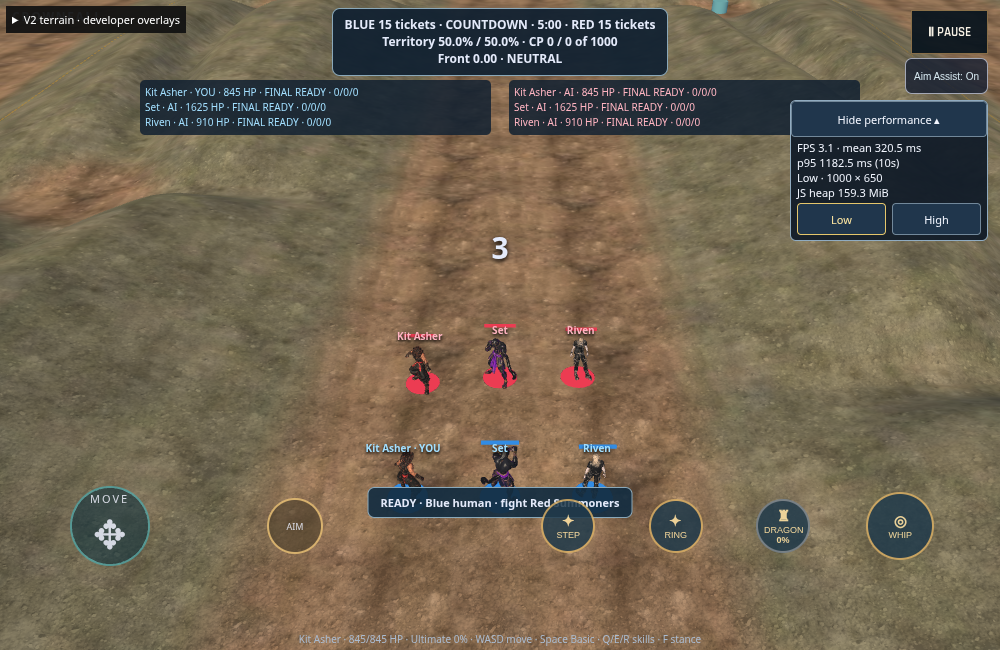
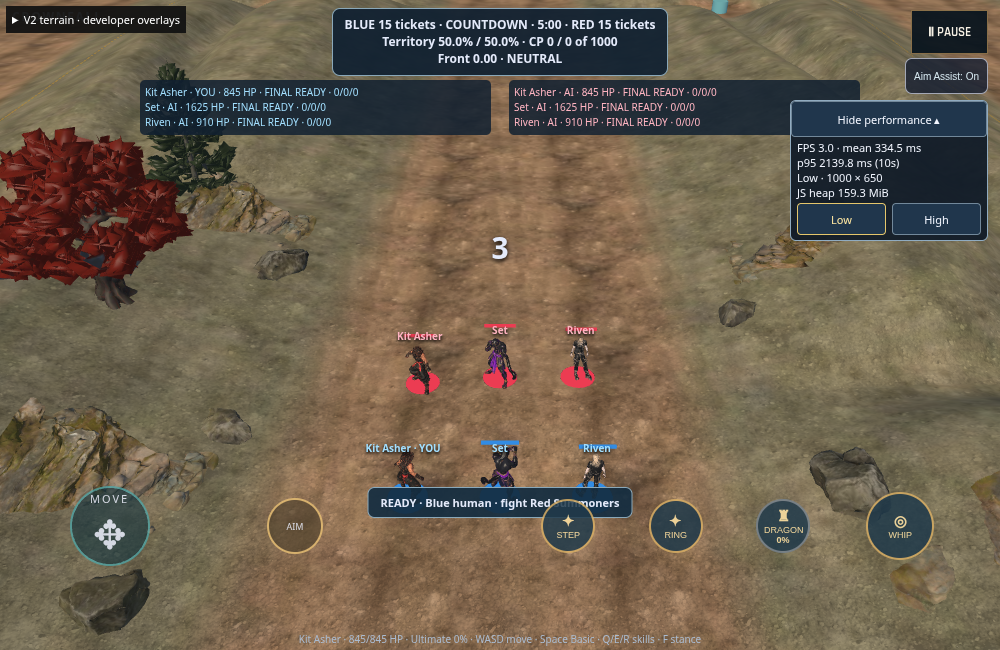

# CROWNFALL ARENA — GOAL 018A

Single-section lane enclosure prototype on `goal-018a-lane-enclosure`, based on
GOAL 017B source `d781667bc5216d32a2dad73de54ee031b66aac45`.

**Play:** https://kalikeefbiz.github.io/-Crownfall-Arena-Unity/solrahn-goal-018a/

Move up the middle lane to Z 14…-12. For immediate review, expand the existing
**V2 terrain · developer overlays** and choose **Inspect: middle-lane**. Return to
**Camera: follow player** to play normally. Deployed source SHA and Pages SHA are
recorded in [publication receipt](evidence/018a/publication.json).

## Delivered composition

One 26m route segment, from world `(0, -12)` to `(0, 14)` in X/Z. Four partially
buried, inward-leaning rock faces; five irregular boulders; two approved pines and
one approved red oak. Existing hills and terrain materials remain intact. The
low saddle stays open, with space between outcrops and a clear combat corridor.

[Exact XYZ positions, rotations, scales and heights](evidence/018a/placement.json)
and [placement source](src/presentation/lane-enclosure-layout.ts).
Tree heights: pine 6.4 / 7.4m; oak 5.8m. The banks remain governed by the original
navigation mask, which permits movement there; the art adds no invisible walls.

Repeated geometry uses static hardware instancing with aggregate frustum bounds.
Six shared meshes, four shared materials, four container downloads and six art
draw batches. New stone geometry and textures total **749,992 bytes**. Including
the two reused tree containers, the enclosure downloads **1,729,540 bytes**.
No tree regeneration, high-resolution reimport, shadows, colliders, terrain
patches or per-frame placement work.

## Acquired and reused assets

| Asset | Source | Runtime triangles | Maps | GLB bytes |
|---|---|---:|---|---:|
| Rock Face 02 | [Poly Haven](https://polyhaven.com/a/rock_face_02) | 2,999 | 1K albedo; 512 normal + ARM | 509,732 |
| Rock Moss Set 02: 09 / 11 / 13 | [Poly Haven](https://polyhaven.com/a/rock_moss_set_02) | 999 / 1,000 / 999 | three shared 512 maps | 240,260 |
| Pine | existing approved Meshy mobile GLB | 2,559 | three 512 maps | 379,620 |
| Red oak | existing approved Meshy mobile GLB | 6,765 | three 512 maps | 599,928 |

Total placed art: **28,876 triangles**. Stone sources are CC0-1.0, credited to
Dario Barresi / Rico Cilliers and Kless Gyzen. The acquired source glTF + .bin
files and all PBR textures passed their original provider MD5 checks. The source
rosters include URL, size, MD5 and SHA-256. The source cliff is an open scan with
an unfinished rear, appropriate for embedding but not a freestanding wall.

[Licensing, source inspection and reproducible processing](public/assets/environment/stones/README.md) ·
[closed runtime manifest](public/assets/environment/stones/manifest.json) ·
[verified source download receipt](public/assets/environment/stones/provenance/download-receipt.json).

## Actual PlayCanvas renders

| Original lane, same camera | Enclosure, same camera |
|---|---|
|  |  |

Matched camera position `[0, 16.300060272216797, 18]`, Euler angles
`[-35.166432482618575, 0, 0]`, identical in both capture receipts. The gameplay
camera function, offsets and FOV are unchanged.

[Normal gameplay camera](evidence/018a/after-gameplay.png) ·
[Rock-to-terrain close view](evidence/018a/after-integration.png) ·
[Top-down placement](evidence/018a/after-topdown.png) ·
[Landscape, six Summoners](evidence/018a/after-mobile-844.png) ·
[Portrait, six Summoners](evidence/018a/after-mobile-390.png).

The mobile roster captures use the pre-existing middle-lane focus to keep all
six models in frame, with normal gameplay camera offsets. Landscape provides
the clearest environment review. Portrait preserves the inherited narrow field
of view and some control/model overlap. Close/top-down inspection changes are
made only by the capture harness, not shipped camera behaviour.

## Validation and performance

Final results are recorded in [verification evidence](evidence/018a/README.md).
The full unit suite, typecheck, scoped lint, build, runtime hash verification,
Chromium/WebKit mobile controls, quality changes, combat, rematch and cancellation
checks are included. Khronos glTF validator reports zero errors; it warns that
tangent space is generated at import. Both browser engines render the normal
maps without observed failures.

The isolated preview preserves all production and prior-preview Git blobs and
file modes. No production merge, heightmap, map layout, camps, navigation,
combat, abilities, animations, match lifecycle, camera behaviour, Blue territory
shader or existing texture changes are included.

The measurements below are comparative software-renderer engineering evidence.
**Physical iPhone Safari performance and native memory are not verified.**

| Software browser | Median FPS before → after | Mean frame ms before → after | p95 ms before → after | Frame-time change |
|---|---:|---:|---:|---:|
| chromium | 2.43 → 1.24 | 410.7 → 805.5 | 750.0 → 1316.7 | +96.1% |
| webkit | 10.15 → 6.95 | 98.6 → 143.8 | 115.0 → 174.0 | +45.9% |

Matched Chromium draw calls: **45 → 51**. PlayCanvas texture accounting: **404.22 → 424.22 MiB**. Vertex buffers: **6.062 → 6.627 MiB**; index buffers: **0.667 → 0.808 MiB**.

Chromium median JS heap observation: **39.65 → 29.71 MiB**. WebKit JS heap/native memory are unavailable; GPU accounting is not physical residency.

**Performance acceptance remains open.** The software-renderer regression is measurable; this report does not claim GOAL 017B performance parity or physical iPhone performance. The smaller candidate reduced asset bytes, GPU memory and draw submissions, but did not eliminate all comparative rendering cost. Actual iPhone Safari testing is required before approving expansion.

Three-round ranges, renderer strings, all intervals and memory observations: [summary](evidence/018a/performance-summary.json) / [raw samples](evidence/018a/performance-raw.json). The benchmark is a matched scene presentation test; functional combat is verified separately.

## Review limits

Founder review is required before extending the enclosure or beginning any
stone-footing work. The photogrammetry / approved stylized tree combination is
ready for visual review, not a declaration of founder art approval. The open
cliff backs must remain embedded. No placement extends into camps, Wilderness
or the rest of the arena. Work stops at this prototype.
