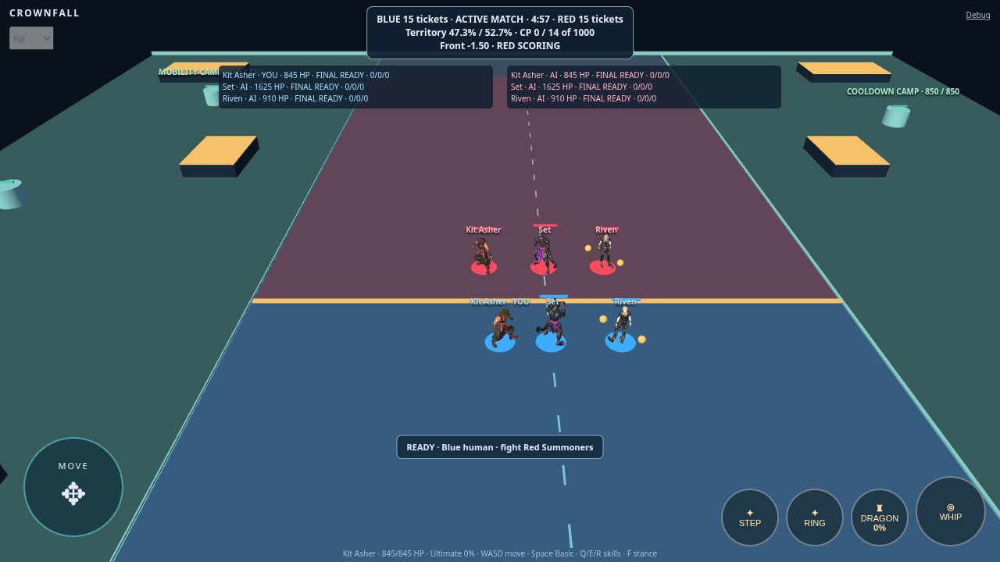

# Goal 007E — full six-summoner 3D integration

Playable preview: <https://kalikeefbiz.github.io/-Crownfall-Arena-Unity/playcanvas/>.
Choose Kit, Set or Riven and start a standard match. No presentation flags are needed.

## Implementation and authority

`scene.ts` joins each target to `match.actors` by authoritative player ID and reads
its combat definition, team, position, angle and death state. Blue roster ordering
is never used as character identity. The local input-facing adapter retains its
established aim/commit/movement priority. AI visual facing follows the authoritative
combat angle. Five independent AI presenters supplement the retained local presenter.
Camps and other non-roster targets continue through the existing primitive path.

`SummonerAssets` owns one container/promise per source URL for the scene lifetime.
Both actors of an identity instantiate from that same container. Their GUIDs,
skeletons, entity transforms and animation controllers are distinct; mesh/material
IDs match. Source and corrected animation tracks are shared safely, while playback
state is per entity. Bind normalization is calculated once per asset. Source GLBs,
textures and authored clips remain unchanged. Kit's existing animation response is
preserved; Riven registers Idle_6, Walking and Running; Set registers Ready/Running.
Neither excluded Riven run_fast_7 nor Set RunFast is used for runtime locomotion.

Team discs and health bars use Blue `#369bff` and Red `#ff425c`, retaining original
character materials. Discs show hit pulse/flash, protection and stun feedback.
Successfully loaded models hide their fallback bodies. Models hide and stop playback
on death, resume on respawn, and stop playback at results. Unchanged actor IDs and
identities reuse instances through rematches. Identity changes dispose the abandoned
actor hierarchy and reuse its new identity's cached container. Local preview models
remain cached, with disabled playback when unselected. Scene disposal destroys
instances before unloading containers, including containers that finish loading late.

No abilities, cooldowns, movement/collision, damage, health, scoring, territory,
Wilderness logic, AI commands, camera, input or match rules were changed. The only
new main-loop fixture is an opt-in `verify=1` roster arrangement for screenshots.

## Automated verification

- Unit tests: **186 passed in 19 files**, including shared-request success/failure,
  single normalization and late-load disposal.
- Typecheck, lint, Prettier and production build passed. The build retains the
  existing large JavaScript chunk advisory (approximately 1.295 MB raw).
- Full production browser suite: **91 passed / 1 new test wait race** in 16.3 minutes.
  The switching check initially accepted six still-visible presenters before the
  next frame updated their identities. Its settled-state wait now also requires
  identity agreement with the authoritative roster and hidden fallback bodies.
- Corrected full roster suite: **7/7 passed** in 1.3 minutes, including all actors'
  death/respawn, rematch GUID reuse, repeated identity changes, and stable entity,
  texture, vertex-buffer and index-buffer allocations after warming the previews.
  Every one of the **92 browser cases** has passing evidence; no known failure remains.
- Logs: [unit suite](evidence/007e/unit-tests.txt), [full browser run](evidence/007e/browser-full.txt),
  [final roster suite](evidence/007e/browser-roster-final.txt).

The natural normal-match browser case has passed with default 3D rendering: all
bots fought, deaths occurred, an authoritative result ended the match, result state
froze, and restart returned clean health/lives/scoring. Both mobile orientations
also passed captured touch movement/combat checks.
The new suite covers all three selected summoners, six distinct instances and exact
roster identities, actual indicator colors, shared mesh/material IDs, independent
idle/run state, facing, fixed grounding, three downloads and three normalizations,
all actors' death/respawn, results/rematch reuse, repeated selection/resource
stability, a failed shared asset, global primitive mode, and normal bot locomotion.
Existing per-character preview, immutable-binary, per-vertex grounding, gameplay,
full-match, Wilderness and captured multi-touch regressions remain enabled.

## Screenshot evidence



- [Kit selected, mobile viewport](evidence/007e/six-kit-mobile.png)
- [Set selected, mobile viewport](evidence/007e/six-set-mobile.png)
- [Riven selected, mobile viewport](evidence/007e/six-riven-mobile.png)

The opt-in roster fixture gathers authoritative actors in view and disables bot
commands for stable captures. It uses normal default 3D rendering, the unchanged
match camera, and all six independent presenters. Natural AI combat and normal
match entry are verified separately without presentation flags.

## Loading, memory and performance

The unchanged assets total **48,110,624 bytes (45.88 MiB)**:

| Identity | Original GLB bytes | Runtime states                    |
| -------- | -----------------: | --------------------------------- |
| Kit      |         26,939,896 | Idle_5, existing locomotion/punch |
| Set      |         10,000,416 | Ready, Running                    |
| Riven    |         11,170,312 | Idle_6, Walking, Running          |

Runtime measurements use production Chromium with ANGLE SwiftShader on this cloud
host. They are **software-rendered measurements**, with no physical iPhone timing
or Safari GPU-memory claim. The [raw benchmark](evidence/007e/software-performance.json) records the following
steady-state results (90 samples per row):

| Mode               | Pixel ratio | Mean / median frame ms | P95 frame ms | JS heap MiB |
| ------------------ | ----------: | ---------------------: | -----------: | ----------: |
| Six animated skins |           1 |          373.0 / 366.7 |        733.3 |       15.86 |
| Primitives         |           1 |          160.7 / 166.6 |        300.0 |       12.86 |
| Six animated skins |           2 |          791.1 / 783.2 |       1583.3 |       16.52 |
| Primitives         |           2 |          552.9 / 533.4 |       1183.3 |       10.34 |

The cloud software renderer is slow even for primitives and is not a usability
acceptance device. Near-load smoothed diagnostics of about 62–70 ms understate
these steady-state frame intervals. No physical-device frame-rate claim is made.

Both 3D cases made exactly three GLB requests and three bind-bound calculations,
with six visible instances and 1,348 scene entities. At pixel ratio 1, source
transfer took 151–492 ms on localhost; request-to-container preparation took
990 ms (Set), 1,485 ms (Riven), and 2,752 ms (Kit). These are local-server timings,
not cellular load-time estimates. The 3D scene reports 268,498,532 texture bytes
(**256.06 MiB**), 4,002,860 vertex-buffer bytes (**3.82 MiB**), and 334,206
index-buffer bytes (**0.32 MiB**). Resource sharing is confirmed by matching mesh
and material IDs across each identity's two distinct model GUIDs. Repeated selection
checks also confirm stable GPU texture/geometry counters after warming the local previews. GPU counters are engine allocations for the entire scene, not OS
resident memory. JavaScript heap measurements exclude GPU allocations and may omit
native images and external ArrayBuffer backing storage; they are not total process
or peak decode memory.

Reproduce the independent benchmark with a production preview server running:

```sh
CHROMIUM_PATH=/usr/bin/chromium node tests/helpers/measure-roster.ts
```

It warms 30 frames, samples 90 animation frames per case, and compares the same
six-actor arrangement in 3D and primitive mode at 844×390, at pixel ratios 1 and 2.
The authoritative simulation is paused after arrangement while skeletal animation
and rendering continue, isolating presentation cost rather than sustained AI combat.
No browser test runs concurrently with this measurement. The host is a Debian
container with a two-core CPU quota and 8 GiB memory limit; Chromium 154.0.8037.57
uses ANGLE SwiftShader. Pixel-ratio emulation does not reproduce iPhone hardware.

The measured software cost includes substantial fill cost (primitive mode slows with
pixel ratio) and added skinning/draw cost. It does not identify a necessary source
texture or mesh reduction on an iPhone. The least destructive optimization is sharing the original containers/resources,
corrected tracks, and bind normalization, and reusing instances across ordinary
lifecycle transitions. No texture reduction, model changes, animation decimation,
camera changes or balance adjustments were made. `?models=primitive` provides a
comparison and recovery option; per-identity switches isolate import costs.

## Physical-device acceptance still required

On a real iPhone in Safari, validate cold-cache loading on a mobile connection,
peak memory during texture decode, six simultaneous skins during combat, sustained
frame pacing and thermal behavior across a full match, repeated rematches/selections,
background/foreground and WebGL context recovery, portrait/landscape safe areas,
movement plus aimed multi-touch actions, and original character appearance/grounding.
Software Chromium and touch emulation do not establish those hardware results.
