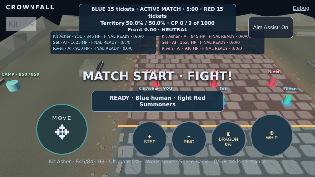
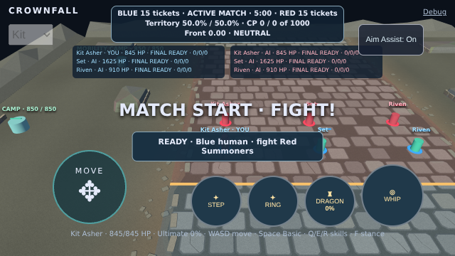

# Goal 007L.1 — mobile HUD flow and release validation

Baseline: `b85c28475652a57a8e1ea3bef12f6d1761c9fbb0`, branch `playcanvas-port`.
Implementation: 8aef93f00158bad178aefa39db59f2ce2ad380ea.
Release revision (includes the browser-driver correction below): `376006bf4b2118e9df901274baa354f688213c43`.
Date: 2026-10-24 UTC.

## Root cause and reproduction

Goal 007L's [CI failure](TASK_007L_VERIFICATION.md) was a real layout collision.
The compact scoreboard used absolute positioning, `left: 50%`, `width: auto`
and a visual `translateX(-50%)`. Its shrink-to-fit available width at 640px
was only 320px: the transform changes painting, not the width calculation.
Participant status was positioned independently at `top: 64px`.

The compact scoreboard uses 10px bold type, 14px line height, 4px vertical
padding and a 1px border. Its three authored lines normally occupy 52px.
With DejaVu Sans, the active-match first line needs a 327.53125px box; the
320px cap wraps its last word, producing four lines and a 66px box.

| 640×360 / 44px inset / DejaVu Sans / Kit active | Before              | Corrected      |
| ----------------------------------------------- | ------------------- | -------------- |
| Scoreboard x / y                                | 160 / 8             | 156.234375 / 8 |
| Scoreboard width / height                       | 320 / 66            | 327.53125 / 52 |
| Scoreboard bottom                               | 74                  | 60             |
| Team status x / y                               | 102.40625 / 64      | 102.40625 / 64 |
| Team status width / height                      | 435.1875 / 46       | 435.1875 / 46  |
| Scoreboard-to-team gap                          | **−10px (overlap)** | **4px**        |

Local system-ui resolves to OpenAI Sans, while Arial resolves to Liberation Sans.
Those narrower fonts masked the original collision: their active scoreboard
boxes were 281.0625px and 284.1875px wide, both 52px high. DejaVu Sans reproduces
it after fonts are ready and the active HUD has updated. Prematch/countdown text
also differs in width, explaining phase sensitivity. The defect is intrinsic
text wrapping combined with unrelated absolute offsets, not an animation-frame
coordinate assumption.

The new regression test was run against a frozen baseline production build using
a temporary local-only configuration. It failed on the exact **−10px** gap. The
corrected build passed the same font/content condition. Neither this intentional
baseline failure nor the focused selectors were used for release validation.
[Baseline reproduction](evidence/007l1/baseline-regression.txt),
[baseline font/phase rectangles](evidence/007l1/baseline-rectangles.json),
[matched before/after measurements](evidence/007l1/layout-measurements.json).

Matched 640×360 / 44px / DejaVu Sans captures use the same neutral, paused
production-game fixture and primitive diagnostic, isolating the HUD change:

| Before                                                                                    | Corrected                                                                                    |
| ----------------------------------------------------------------------------------------- | -------------------------------------------------------------------------------------------- |
|  |  |

The original CI's full-game [before frame](evidence/007l/ci-browser-last-frame.jpeg)
is retained. The corrected complete-suite captures exercise real game rendering
and all three selected summoners at every required mobile size:

| Viewport / inset | Kit                                                           | Set                                                           | Riven                                                           |
| ---------------- | ------------------------------------------------------------- | ------------------------------------------------------------- | --------------------------------------------------------------- |
| 844×390 / 0      | [capture](evidence/007l1/screenshots/task005a-844-0-Kit.png)  | [capture](evidence/007l1/screenshots/task005a-844-0-Set.png)  | [capture](evidence/007l1/screenshots/task005a-844-0-Riven.png)  |
| 844×390 / 44     | [capture](evidence/007l1/screenshots/task005a-844-44-Kit.png) | [capture](evidence/007l1/screenshots/task005a-844-44-Set.png) | [capture](evidence/007l1/screenshots/task005a-844-44-Riven.png) |
| 667×375 / 44     | [capture](evidence/007l1/screenshots/task005a-667-44-Kit.png) | [capture](evidence/007l1/screenshots/task005a-667-44-Set.png) | [capture](evidence/007l1/screenshots/task005a-667-44-Riven.png) |
| 640×360 / 44     | [capture](evidence/007l1/screenshots/task005a-640-44-Kit.png) | [capture](evidence/007l1/screenshots/task005a-640-44-Set.png) | [capture](evidence/007l1/screenshots/task005a-640-44-Riven.png) |

[Final 324 component conditions and 24 real-game rectangle groups](evidence/007l1/full-layout-measurements.json)
include READY and long HIT feedback, touch controls, safe-area bounds and all
selected summoners. [Matched after rectangles](evidence/007l1/after-rectangles.json).

## Focused correction

Only `src/style.css` and `src/ui/hud.ts` change production code.
A neutral `#match-overview` wrapper contains the existing scoreboard, participant
status, Wilderness reward row and kill feed. It uses CSS column flow, centered
inside the available safe area. Compact/desktop/portrait widths and the portrait
top inset remain responsive. Participant columns retain their sizing, type,
colors and content.

The scoreboard uses its content width, capped by the wrapper, and a 4px bottom
margin. Participant status follows the scoreboard's **actual** height. Reward
and feed rows follow naturally too, so longer rows cannot collide with the next
fixed offset. Old absolute positions and their later `top` overrides are removed
for these rows. The reward row can wrap inside the viewport's safe width.

No DOM measurement, per-frame positioning, resize listener or new dependency is
added to production. Essential text and existing IDs/ARIA regions are retained.
No panel is hidden for layout compliance. Combat-button sizes, movement pad,
ability/stance positions, safe-area variables, feedback and announcements are
unchanged. Results and actual restart still use the existing application flow.

The complete combat, AI, rules, movement, aim assistance, camera, presenter,
asset ownership, teardown, runtime-contract and public-asset sources are
unchanged. The Goal 007L workflow is unchanged.
[Protected-source comparison](evidence/007l1/scope-parity.json).

## Verification and screenshot timeout investigation

All four original responsive production-game tests remain, exercising Kit, Set
and Riven at:

- 844×390, safe inset 0;
- 844×390, safe inset 44;
- 667×375, safe inset 44;
- 640×360, safe inset 44.

Every existing overlap, bounds, safe-area, touch-action, 72px secondary target,
88px Basic target and Riven stance assertion is preserved. Geometry groups are
now read in one browser task, so comparisons use one layout instant instead of
separate traced protocol calls. Missing/hidden boxes still fail. Actual bounds
are attached to the browser report for both READY and long HIT messages.

The two prior local timeouts were at screenshot capture, not failed layout
assertions. The existing trace recorded completed screenshots lasting 8–16
seconds, with another capture pending when the 60-second case budget expired.
A controlled capture benchmark kept the 844×390 viewport, DPR=2, production
models, rendering flags and tracing. Three device-pixel PNGs took 37.615 seconds;
CSS-pixel PNGs took 26.754 seconds. The canvas remained 1688×780 in both cases;
only exported PNG dimensions changed from 1688×780 to 844×390. The original
real-game geometry assertions still run at DPR=2 and the same viewport.
[Capture benchmark](evidence/007l1/capture-probe.json).

The layout tests now export CSS-pixel screenshots and batch their measurement
calls. No global or individual timeout was increased. Real-game layout captures do not
stop animations, and no rendering or Riven animation assertion was modified. The four focused
real-game tests then passed in 49.001, 55.706, 49.125 and 52.380 seconds, within
the original 60-second limit on this 2-CPU / 8-GiB workspace.
[Focused case timings](evidence/007l1/capture-layout-results.json).

Six additional component cases exercise those four sizes plus 390×844 portrait
and 1280×720 desktop. They use the existing actual-HUD/actual-simulation fixture
boundary, extending its optional selected-summoner argument. Each case checks
three font families, all three summoners and six states: prematch, countdown,
active, legitimate long pressure/CP/participant strings, regulation results and
fresh restart state. Both teams must still have three visible participant rows;
results must include six participants. This is **324 measured conditions**, all
with a scoreboard-to-participant gap of at least 4px. The original full-game
match/restart tests continue to test real interactions and animated assets.

### Independent touch-driver defect exposed by the full run

The first complete local run on `8aef93f` executed all 114 cases with zero retries:
**113 passed / one failed**. Every HUD/layout case and the original Riven preview
case passed. The failure was the unchanged simultaneous movement/Basic-finger
case in `touch-combat.spec.ts`: after requesting ability-finger release, it
observed `movement.x === 0` instead of positive movement. The completed summary and original trace are preserved.

The failing case uses the debug sandbox, where the match HUD is hidden.
The cause was verified on **two plain HTML buttons with no game code**. The old
`end(id)` helper removed the released point from its Map and sent the **remaining**
points to `Input.dispatchTouchEvent({type: 'touchEnd'})`. Chromium interprets the
supplied points as the released set: requesting ability release with only the
movement point in the list emitted trusted `pointerup`/`lostpointercapture` on
**movement**. Sending the actual ability point emitted those events on ability
instead. The game trace likewise showed movement changing from 0.148148 to zero
while the ability pointer remained down; the player was alive with no statuses.
This is a browser-test driver error, independent of HUD styling.
[Native-event probe](evidence/007l1/touch-protocol-probe.json),
[first-run touch samples](evidence/007l1/local-touch-samples.json),
[first full log](evidence/007l1/browser-first.txt).

Only the browser helper was corrected: retain the released point, remove it from
the active Map, and send `touchEnd` with `[released]`. The generic remaining-point
sender can no longer accept `touchEnd`. The failing test now additionally checks
that exactly one native pointer-up targets `ability-whip` and none targets
`move`; all original damage, movement and capture assertions remain unchanged.
Production input, abilities and movement code are untouched. All 15 touch cases
passed after the driver repair; the strengthened native-event case also passed.
No automatic test retry was introduced.

The first source push started
[CI 40060320321](https://github.com/kalikeefbiz/-Crownfall-Arena-Unity/actions/runs/40060320321).
It was explicitly cancelled during validation once the driver defect was identified,
so the superseded revision published nothing. The corrected release revision
receives a new complete local run and an independent complete CI run. This is a
code correction, not a rerun of an unchanged failed test to obtain green status.

The corrected release revision's **complete local suite passed all 114 cases in
35.7 minutes**, with **zero skipped, zero flaky and zero retry results**. Every
original Riven/Set animation assertion passed locally without modification.
Clean installation, all 224 unit tests in 22 files (30.80 seconds), typecheck,
ESLint, Prettier and production build passed too.
[Final local results](evidence/007l1/browser-final-summary.json),
[full local browser log](evidence/007l1/browser-final.txt),
[unit](evidence/007l1/unit.txt), [typecheck](evidence/007l1/typecheck.txt),
[lint](evidence/007l1/lint.txt), [format](evidence/007l1/format.txt),
[build](evidence/007l1/build.txt).

The first failed local run and both revisions' results are reported separately;
no automatic retry or test exclusion conceals the first failure.

## CI, validated artifact and publication

[CI run 40060983463](https://github.com/kalikeefbiz/-Crownfall-Arena-Unity/actions/runs/40060983463)
checked out the exact release SHA `376006bf4b2118e9df901274baa354f688213c43`.
Installation, 224 unit tests, typecheck, ESLint, Prettier and production build
passed. The complete production browser suite executed **114 cases: 112 passed /
2 failed in 30.6 minutes**, with zero skipped tests and zero automatic retries.
All original HUD tests, all six new layout cases and the repaired native-touch
case passed in CI.

The failures are the unchanged combined animation assertions in
`riven-model.spec.ts:130` and `set-model.spec.ts:130`. Each 40-frame sample contains
**39 Running frames and one idle frame** (`Idle_6` for Riven, `Ready` for Set).
Both sample arrays have **zero horizontal hip-coordinate spread**. The assertion
still requires Running for every sample as well as its original hip constraints.
The original assertions and all animation/presenter sources remain unchanged.
[Exact Riven samples](evidence/007l1/ci-riven-samples.json),
[Set samples](evidence/007l1/ci-set-samples.json),
[Riven error context](evidence/007l1/ci-riven-context.txt),
[Set context](evidence/007l1/ci-set-context.txt).

Validation failed, so **publication was skipped**. The validated-build identity
and upload steps were skipped; **no validated-build artifact exists**. Only
[browser evidence artifact 12548342124](https://github.com/kalikeefbiz/-Crownfall-Arena-Unity/actions/runs/40060983463/artifacts/12548342124)
was uploaded (78,242,608 bytes, retained until 2026-11-07 UTC). The downloaded
archive matches its GitHub SHA-256 digest:
`52590431eb841a5e3acbc426e3d0dfb7a4d036ac4efa449c5ce9fd746ad48d5c`.
It preserves both original traces, screenshots and the HTML report. Raw archive:
`/workspace/007l1-ci-browser-evidence.zip` in this workspace; committed sample
arrays, error contexts and hashes provide durable failure evidence. Committed
text logs trim trailing whitespace only; the downloaded archive and original
traces remain unchanged.
[CI log](evidence/007l1/ci-log.txt), [job/step conclusions](evidence/007l1/ci-run.json),
[artifact metadata](evidence/007l1/ci-artifacts.json).

There was no CI rerun after the failures. Per this goal's failure policy, release
remains blocked rather than changing, skipping or weakening animation checks.
The validation-to-build-artifact-to-publication chain remains unchanged from
Goal 007L; its positive artifact handoff has not executed because validation did
not succeed.

## Delivered output, live game and existing Unity hosting

**No publication occurred.** The existing publication revision remains
`cd43d91352f4906925f73600542c83ac2a8f3493`. The complete `gh-pages` root tree is
identical before and after this work, including Unity `Build/`, root `index.html`,
`_headers`, `.nojekyll` and the previously published PlayCanvas subtree.
[Before tree](evidence/007l1/pages-before.json), [after tree](evidence/007l1/pages-after.json),
[before refs](evidence/007l1/refs-before.txt), [after refs](evidence/007l1/refs-after.txt).
Pages remains the existing legacy `gh-pages:/` site.

| Output                     | Asset                       | SHA-256                                                            |
| -------------------------- | --------------------------- | ------------------------------------------------------------------ |
| Tested local candidate JS  | `assets/index-CSTEtNkC.js`  | `4bbaaaca793c3157604a83d68b1f8d2ac0dd0d71a84c4064191728f556457e22` |
| Tested local candidate CSS | `assets/index-D-9p9G16.css` | `601081d02761817f1f1121214ead098bb099aea8a9a7519016ac1efc50b56421` |
| Still deployed prior JS    | `assets/index-BSBNewh8.js`  | `cd79f71c265c23f10a38052ea9fb35986012c8275869db4d95c39a4c0622f1ae` |
| Still deployed prior CSS   | `assets/index-BG9Ns0t1.css` | `75297fb99a9b6d86fcce654187af15365775261dc680d669e0e4cab327162539` |

[Source file hashes](evidence/007l1/source-hashes.json),
[complete candidate build hashes](evidence/007l1/local-build-hashes.json).
CI loaded the same candidate asset names. Its retained CSS body hashes identically
to the local candidate; the JavaScript body is absent from the trace. Since no
successful validated-build artifact was uploaded, no CI-validated JavaScript
archive or positive artifact-to-deployment comparison is claimed.
[CI trace resource metadata](evidence/007l1/ci-tested-build-hashes.json).

A separate read-only check of the **unchanged prior live game** loaded the actual
Start match flow, six visible animated actors with six distinct instance IDs,
three shared GLB downloads, advancing animation playback, and no browser errors.
Its HTTP index/JS/CSS/GLB bytes match the frozen pre-goal build. A subsequent
client-local roster fixture preserved all instance IDs and supplied a six-actor
view. The Unity root HTTP response matches its original Git blob too.
[Existing live check](evidence/007l1/existing-live-verification.json),
[normal game](evidence/007l1/existing-live-normal.png),
[six-actor view](evidence/007l1/existing-live-six-roster.png).
These are checks of the prior live release, **not** verification that this HUD
correction reached production. No release gate was bypassed.

## Remaining limitations

The requested responsive HUD correction is verified, and all local checks pass.
The full release success condition is **not met**: CI's animation-frame assertions
block the new build, so publication, consumption of a successful validated-build
artifact, and live verification of the corrected revision cannot be claimed.
Addressing those timing/animation expectations requires a separate authorized
change; this goal retains the existing assertions and presenter behavior.

The viewport/font matrix uses the supported Playwright Chromium with emulated
safe-area CSS values and real DPR=2 layout. It is not physical iOS/Safari device
coverage. The existing Vite large-chunk advisory is unchanged. Browser artifacts
expire after 14 days; committed logs and sample records preserve their findings.
